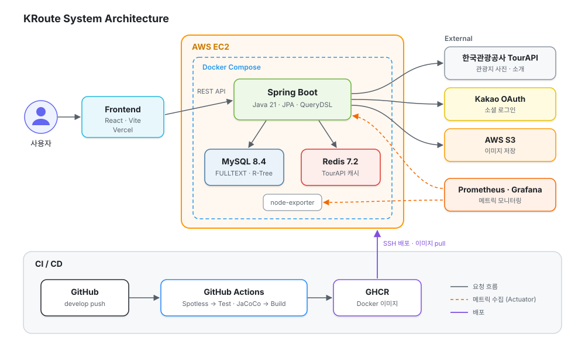

# KRoute — 최애의 발자취를 따라서 (Backend)

**KRoute**는 팀 TraceK가 만든 K-콘텐츠 촬영지 관광 서비스입니다. K-콘텐츠 촬영지를 지도와 검색으로 탐색하고, 위치 기반 방문 인증을 랭킹에 반영하는 팬 참여형 관광 서비스입니다.
2026 관광데이터 활용 공모전 출품작 · 2026.07 – 2026.10

🔗 **서비스:** https://frontend-iota-six-60.vercel.app · **Frontend:** [TY-TraceK/frontend](https://github.com/TY-TraceK/frontend)

## 주요 기능
- **지도·관광지**: 지도 범위 기반 촬영지 조회, 관광지 상세(한국관광공사 TourAPI 연동), 좋아요
- **콘텐츠·아티스트**: 드라마·예능 등 콘텐츠와 회차(Episode)별 촬영지·출연 아티스트 조회
- **검색**: 콘텐츠·아티스트·관광지 통합 검색 (MySQL FULLTEXT ngram)
- **방문 인증·랭킹**: 위치 기반 방문 인증, 팬 활동 랭킹
- **회원**: 카카오 OAuth 로그인, JWT 인증

## 시스템 아키텍처



- `develop` 브랜치에 푸시하면 코드 포맷 검사(Spotless) → 테스트와 커버리지 검사(JaCoCo, 라인 70% 미만이면 실패) → 빌드 → GHCR 이미지 푸시 → EC2 배포가 자동으로 진행됩니다.
- 애플리케이션 메트릭(Actuator·Micrometer)과 서버 메트릭(node-exporter)을 Prometheus로 수집해 Grafana로 확인합니다.

## 기술 스택
| 영역 | 기술 |
|---|---|
| Backend | Java 21 · Spring Boot 3.5 · Spring Security · JPA · QueryDSL |
| Data | MySQL 8.4 · Redis 7.2 · AWS S3 |
| Infra | Docker · GitHub Actions · GHCR · AWS EC2 |
| Quality | JUnit 5 · JaCoCo · Spotless |
| Frontend | React · Vite · Axios · Kakao Map · Vercel |
| Monitoring | Actuator · Micrometer · Prometheus · Grafana |

## 패키지 구조
도메인마다 같은 계층 구조를 따릅니다.

```
src/main/java/com/tracek
├── domain
│   ├── location · content · artist · search · image      # 관광지 · 지도 · 콘텐츠 · 아티스트 · 검색
│   ├── auth · user · fan · visitVerification · ranking   # 인증 · 회원 · 팬 · 방문 인증 · 랭킹
│   └── <domain>/
│       ├── presentation     # controller · request · response
│       ├── application      # service · facade · dto · 외부 연동 포트
│       ├── domain           # model · repository(포트) · exception
│       └── infrastructure   # JPA 구현 · 외부 API 어댑터
└── global                   # config · security · exception · response
```

- 다른 도메인의 데이터는 그 도메인의 Repository가 아니라 **QueryService**로만 조회합니다.
- 여러 도메인을 조합하는 조회는 **Facade**에서 처리합니다.
- 외부 API(TourAPI·OAuth·S3)는 애플리케이션 계층의 포트(인터페이스)와 인프라 계층의 어댑터로 분리했습니다.

## 팀 구성
| 이름 | 역할 | 담당 |
|---|---|---|
| 백유진 ([@YujinB](https://github.com/YujinB)) | Backend · Frontend | 관광지 · 지도 · 콘텐츠 · 아티스트 · 검색 · 이미지 (API · 화면 연동), CI/CD |
| 송유진 ([@0000yuyu](https://github.com/0000yuyu)) | Backend · Frontend | 인증 · 회원 · 팬 · 방문 인증 · 랭킹 |
| 안다솜 ([@d97s111m](https://github.com/d97s111m)) | Design · Frontend | UI/UX 디자인, 화면 구현 |

## 기술적 개선

### 관광지 · 지도 · 콘텐츠 · 검색 (백유진)
| 주제 | 결과 | 상세 |
|---|---|---|
| 핫스팟 좋아요 Lost Update 재현과 락 전략 실측 비교 | 동시 100건 중 87% 누락 → 0%, 비관적·낙관적 락 성공률 비교 후 비관적 락 채택 | [상세](https://mini-clerk-115.notion.site/Lost-Update-3eaf2dc8bb4f81c58bd1e0b8f3521f6a) |
| TourAPI 응답 Redis 캐싱 (Cache-Aside · TTL Jitter · 장애 폴백) | 관광지 상세 서버 처리 시간 580ms → 16ms (97%↓), 외부 API 호출 75%↓ | [상세](https://mini-clerk-115.notion.site/API-TourAPI-Redis-3f7f2dc8bb4f813c8feee70796e00d6d) |
| Episode 허브 도메인 모델과 DDD 경계를 지킨 N+1 개선 | Fetch Join 대신 ID 기반 IN절 배치 조회로 쿼리 수를 참조 도메인 수 기준으로 고정 | [상세](https://mini-clerk-115.notion.site/Episode-DDD-3eaf2dc8bb4f81ba9264ff0562a8d0db) |
| 지도 조회 범위별 공간 인덱스(R-Tree) 하이브리드 | 기본 화면 2.52ms → 1.10ms, 10만 건 시뮬레이션 75.7ms → 7.5ms | [상세](https://mini-clerk-115.notion.site/3f7f2dc8bb4f81d39b9ced70fd1909d1) |
